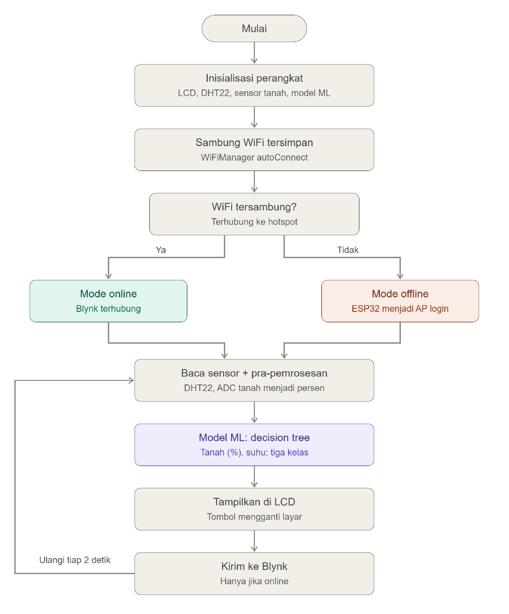

# Sistem Rekomendasi Penyiraman Cabai Berbasis IoT dan Machine Learning (Decision Tree)

[](https://colab.research.google.com/github/faxml/Rekomendasi-penyiraman-cabai-menggunakan-sensor-DHT22-dan-kelembapan-tanah-berbasis-IOT/blob/main/data%20training%20by%20colab/model_penyiraman_cabai.ipynb)

Proyek ini merupakan implementasi **Embedded Machine Learning (Edge AI)** pada mikrokontroler **ESP32** untuk memberikan rekomendasi penyiraman tanaman cabai secara otomatis dan *real-time*. Sistem membaca kondisi suhu dan kelembapan udara menggunakan sensor **DHT22** serta tingkat kelembapan tanah menggunakan **Capacitive Soil Moisture Sensor v1.2**, lalu memprosesnya secara lokal menggunakan model **Decision Tree** tanpa bergantung pada komputasi *cloud*.

---

## Daftar Isi
- [Fitur Utama](#fitur-utama)
- [Struktur Direktori](#struktur-direktori)
- [Arsitektur & Desain Perangkat Keras](#arsitektur--desain-perangkat-keras)
- [Alur Kerja Sistem (Flowchart)](#alur-kerja-sistem-flowchart)
- [Dataset & Pelatihan Model (Machine Learning)](#dataset--pelatihan-model-machine-learning)
- [Integrasi IoT & Dashboard Blynk](#integrasi-iot--dashboard-blynk)
- [Hasil Implementasi Alat](#hasil-implementasi-alat)
- [Cara Penggunaan](#cara-penggunaan)

---

## Fitur Utama
* **Inferensi Edge AI On-Device:** Model *Decision Tree* diekspor ke dalam header C++ (`model_3kelas.h` berukuran ~2 KB) menggunakan `micromlgen`, sehingga prediksi berjalan cepat di ESP32 bahkan saat koneksi internet terputus (*offline mode*).
* **Kalibrasi Sensor Tanah Non-Linear:** Menggunakan pemetaan *piecewise linear* dan rata-rata 16 sampel pembacaan ADC (12-bit) untuk menghasilkan persentase kelembapan tanah (`0% - 100%`) yang akurat.
* **Antarmuka Multi-Layar LCD 16x2:** Menampilkan 4 halaman informasi (Rekomendasi AI, Suhu & Kelembapan Udara, Kelembapan Tanah & Status, serta Status Koneksi WiFi/Blynk) yang dapat diganti melalui tombol fisik maupun tombol virtual di Blynk.
* **Manajemen WiFi Adaptif & Auto-Reconnect:** Dilengkapi *WiFiManager* (`SmartPlant_Setup`) yang otomatis membuka *Access Point* konfigurasi saat jaringan terputus sekaligus melakukan percobaan sambung ulang (*auto-reconnect*) setiap 10 detik tanpa memblokir pembacaan sensor.

---

## Struktur Direktori

```text
Rekomendasi-penyiraman-cabai-menggunakan-sensor-DHT22-dan-kelembapan-tanah-berbasis-IOT/
├── data training by colab/
│   ├── dataset_3_kelas_aman.csv       # Dataset latih & uji (3.000 baris data)
│   └── model_penyiraman_cabai.ipynb   # Notebook Google Colab pelatihan & ekspor model
├── image/
│   ├── dashboard blynk.png            # Tampilan dashboard monitoring Blynk
│   ├── desain pengkabelan.png         # Skematik rangkaian komponen (Cirkit Designer)
│   ├── diagram blok.png               # Diagram blok input-proses-output sistem
│   ├── flowchart wifi.png             # Diagram alir manajemen koneksi WiFi & reconnect
│   ├── flowchart.png                  # Diagram alir utama pembacaan sensor & prediksi AI
│   └── hasil alat.jpg                 # Foto purwarupa perangkat keras pada tanaman cabai
├── sketch/
│   ├── model_3kelas.h                 # Header C++ hasil konversi model Decision Tree
│   └── sketch.ino                     # Kode program utama ESP32
└── README.md
```

---

## Arsitektur & Desain Perangkat Keras

### Diagram Blok Sistem
Sistem terdiri dari tiga komponen input utama (Pushbutton, Sensor Kelembapan Tanah v1.2, dan DHT22) yang diproses oleh ESP32 DevKit menggunakan model *Decision Tree* 3 kelas, lalu menghasilkan keluaran ke layar LCD 16x2 dan aplikasi Blynk.

<p align="center">
  
</p>

### Desain Pengkabelan (Wiring)
<p align="center">
  
</p>

#### Konfigurasi Pin ESP32
| Komponen | Pin Komponen | Pin ESP32 | Keterangan |
| :--- | :--- | :--- | :--- |
| **Sensor DHT22** | `OUT` (Data) | `GPIO 4` | Pembacaan suhu (°C) dan kelembapan udara (%) |
| **Capacitive Soil Moisture v1.2** | `AOUT` (Analog) | `GPIO 34` | Input ADC 12-bit (`ADC_11db`), kalibrasi `RAW_DRY=2520`, `RAW_WET=900` |
| **LCD 16x2 (Modul I2C `0x27`)** | `SDA` / `SCL` | `GPIO 21` / `GPIO 23` | Tampilan lokal 4 halaman informasi |
| **Pushbutton** | Signal | `GPIO 18` | Mode `INPUT_PULLUP` untuk berpindah layar menu LCD |

---

## Alur Kerja Sistem (Flowchart)

### 1. Alur Utama Sistem & Inferensi AI
Setelah inisialisasi perangkat keras dan koneksi WiFi, sistem menjalankan siklus pembacaan sensor, normalisasi data, prediksi kelas penyiraman oleh model *Decision Tree*, pembaruan tampilan LCD, dan pengiriman telemetri ke Blynk setiap **2 detik**.

<p align="center">
  
</p>

### 2. Alur Manajemen Koneksi WiFi & Auto-Reconnect
Sistem memantau status koneksi WiFi pada setiap siklus `loop()`. Jika koneksi terputus, ESP32 beralih ke mode `WIFI_AP_STA` untuk mengaktifkan portal konfigurasi `SmartPlant_Setup` sambil tetap mencoba terhubung kembali ke SSID terakhir secara berkala tiap **10 detik**.

<p align="center">
  
</p>

---

## Dataset & Pelatihan Model (Machine Learning)

Pelatihan model dilakukan di Google Colab menggunakan `scikit-learn` pada file `data training by colab/dataset_3_kelas_aman.csv`.

### 1. Spesifikasi Dataset & Fitur
* **Total Data:** `3.000` sampel data (`6` kolom awal: `Soil Moisture`, `Temperature`, `Air Humidity`, `Pump Data`, `soil_pct`, `Pump_Class`).
* **Normalisasi Kelembapan Tanah (`soil_pct`):** Nilai mentah sensor dinormalisasi ke rentang `0%` (kering) hingga `100%` (basah). Pada implementasi ESP32, persentase dihitung dari kalibrasi ADC perangkat keras.
* **Fitur Input Model (`FITUR`):** `["soil_pct", "Temperature"]` *(urutan array input pada ESP32 harus sama persis)*. Fitur `Air Humidity` tidak digunakan karena tidak memengaruhi aturan pelabelan.
* **Pembagian Data (*Split*):** `80%` data latih (`2.400` baris) dan `20%` data uji (`600` baris) menggunakan *Stratified Random Split* (`random_state=1`).

### 2. Aturan Pelabelan 3 Kelas
Label target (`Pump_Class`) dibentuk berdasarkan kombinasi ambang batas kelembapan tanah (`40%` & `60%`) dan suhu lingkungan (`30°C` & `32°C`):

| Kelas | Label Model | Teks LCD / Blynk | Indikator Warna | Kondisi Aturan Pelabelan | Jumlah Data |
| :---: | :--- | :--- | :---: | :--- | :---: |
| **0** | `Tanah Cukup` | `Tdk prlu siram` | `#2E7D32` (Hijau) | Kelembapan tanah `> 60%`, **atau** `40%–60%` dengan suhu `< 30°C` | `1.621` |
| **1** | `Siram Ringan` | `Siram Ringan` | `#F9A825` (Kuning) | Kelembapan tanah `40%–60%` dengan suhu `≥ 30°C`, **atau** `< 40%` dengan suhu `< 32°C` | `1.048` |
| **2** | `Wajib Siram` | `Wajib Siram!` | `#D32F2F` (Merah) | Kelembapan tanah `< 40%` **dan** suhu `≥ 32°C` | `331` |

### 3. Hasil Evaluasi Model (`DecisionTreeClassifier`)
Model dilatih dengan parameter `max_depth=4` dan `random_state=1` untuk memastikan aturan batas keputusan tertangkap presisi tanpa *overfitting* serta tetap ringan dijalankan di mikrokontroler.

* **Akurasi Data Uji (600 sampel):** `99.8%` (`599` prediksi benar, hanya `1` kesalahan pada batas kelas *Tanah Cukup* ke *Siram Ringan*)
* **Validasi Silang 5-Lipatan (*5-Fold Cross-Validation*):** `99.87%`
* **Tingkat Kepentingan Fitur (*Feature Importance*):**
  * `soil_pct` (Kelembapan Tanah): **`61.4%`** (`0.614`)
  * `Temperature` (Suhu Udara): **`38.6%`** (`0.386`)

#### Classification Report (Data Uji)
| Kelas | Precision | Recall | F1-Score | Support |
| :--- | :---: | :---: | :---: | :---: |
| **Tanah Cukup (0)** | 1.000 | 0.997 | 0.998 | 324 |
| **Siram Ringan (1)** | 0.995 | 1.000 | 0.998 | 210 |
| **Wajib Siram (2)** | 1.000 | 1.000 | 1.000 | 66 |
| **Accuracy / Weighted Avg** | **0.998** | **0.998** | **0.998** | **600** |

---

## Integrasi IoT & Dashboard Blynk

Perangkat terhubung ke platform **Blynk IoT** untuk pemantauan jarak jauh dan kontrol layar LCD secara virtual.

<p align="center">
  
</p>

### Konfigurasi Virtual Pin Blynk
| Virtual Pin | Tipe Widget | Fungsi |
| :---: | :--- | :--- |
| **`V0`** | Gauge | Menampilkan data **Suhu Udara** (`°C`) dari DHT22 |
| **`V1`** | Gauge | Menampilkan data **Kelembapan Udara** (`%`) dari DHT22 |
| **`V2`** | Gauge | Menampilkan persentase **Kelembapan Tanah** terkalibrasi (`%`) |
| **`V4`** | Label / Status Display | Menampilkan **Status Rekomendasi Siram** beserta perubahan warna latar dinamis (`setProperty`) |
| **`V6`** | Button (Push) | Simulasi tombol fisik untuk mengganti halaman tampilan LCD secara jarak jauh |
| **`V10` & `V11`** | LCD Widget | *Mirroring* teks baris 1 (`V10`) dan baris 2 (`V11`) yang sedang tampil pada LCD fisik |

---

## Hasil Implementasi Alat

Purwarupa perangkat dipasang pada tiang penyangga di pot tanaman cabai dengan box panel pelindung komponen (ESP32, LCD 16x2, dan Pushbutton), sensor DHT22 di bagian atas box, serta probe *Capacitive Soil Moisture Sensor* yang tertancap di media tanam.

<p align="center">
  
</p>

---

## Cara Penggunaan

1. **Pelatihan Ulang Model (Opsional):**
   * Buka `data training by colab/model_penyiraman_cabai.ipynb` di Google Colab atau Jupyter Notebook.
   * Pastikan file `dataset_3_kelas_aman.csv` berada pada direktori yang sama, lalu jalankan seluruh sel untuk menghasilkan file header `model_3kelas.h`.
2. **Upload Program ke ESP32:**
   * Buka `sketch/sketch.ino` menggunakan Arduino IDE dan pastikan file `sketch/model_3kelas.h` berada dalam satu folder sketch yang sama.
   * Instal library yang dibutuhkan: `Blynk`, `WiFiManager`, `LiquidCrystal_I2C`, dan `DHT sensor library`.
   * Sesuaikan `BLYNK_TEMPLATE_ID`, `BLYNK_TEMPLATE_NAME`, dan `BLYNK_AUTH_TOKEN`, lalu unggah ke board **ESP32 Dev Module**.
3. **Konfigurasi WiFi Awal:**
   * Saat pertama kali dinyalakan dan belum terhubung ke WiFi, sambungkan ponsel/laptop ke jaringan WiFi **`SmartPlant_Setup`** untuk memasukkan kredensial WiFi Anda.